# Project tour

The long-form view of Quantum Link Research: the computed numbers, every interactive page, the systems engineering, the mission phases, and the figures. Start with the [README](README.md) for what is implemented and how to run it. Earth–Mars, repeater, and memory results here are **research models**, not demonstrated hardware links.

> **Can two people, one on Earth and one on Mars, share a key that an eavesdropper cannot learn?**
> Under stated assumptions (trusted, characterized devices; authenticated classical messages; a finite-key analysis matched to the protocol), quantum key distribution can in principle give a guarantee that does not depend on an adversary's computing power. None of that is demonstrated here for Mars. There is also a catch: entanglement carries no message by itself, and the two classical bits every teleportation needs take minutes at the speed of light. This repository computes what that catch costs, what hardware could pay it, and what a student can build on the way, in code where every formula is cited, every module has an analytic test, and every requirement maps to a test that CI must actually run and pass. Everything on this page is a model output or a plan unless it says measured.

<p align="center">
  <a href="https://Normansrule.github.io/quantum-link-research/">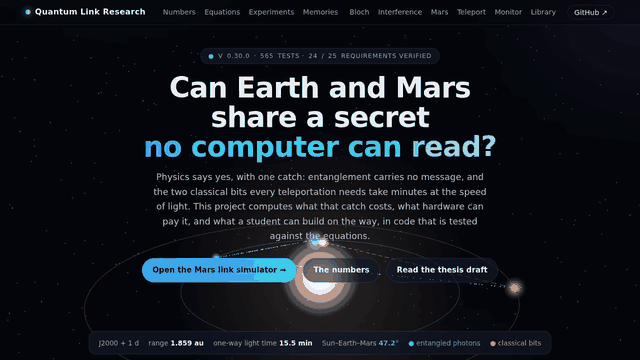</a>
  <br><sub>The live landing page, recorded in headless Chromium: planets placed by the same Kepler ephemeris the Python tests check.</sub>
</p>

## The answer, computed

<p align="center"></p>

Every number above is written by [`scripts/make_readme_art.py`](scripts/make_readme_art.py) from `docs/site_data.json`, which [`scripts/build_site_data.py`](scripts/build_site_data.py) regenerates from the tested code on every commit, so the README, the website, and the thesis quote the same computation. That keeps the displays consistent with each other; it is not independent validation, since one wrong equation would propagate everywhere. The test count is an inventory of collected tests; pass and fail results come from the CI run.

<details>
<summary><b>The full table, with the module that computes each number</b></summary>

<!-- numbers:start -->
| Question | Answer from the code | Module |
|---|---|---|
| One-way light time, Earth → Mars | **3.1–22.3 min** | `qll/space/ephemeris.py` |
| Round trip a memory must survive (Mars max) | **44.6 min** | `qll/channels/light_time_delay.py` |
| Demonstrated memories that survive it (f₀ = 0.95) | **3 of 6: hour-class ions (99 % retrieval) and rare-earth crystals (< 5 %)** | `qll/network/memory_decoherence.py` |
| Micius two-downlink loss at 30° elevation | **65.7 dB (reported 64–82 dB)** | `qll/channels/link_budget.py` |
| Thermal photons a 5 GHz qubit sees | **1250 at 300 K, 1.1e-07 at 15 mK** | `qll/circuits/noise/thermal.py` |
| BB84 error threshold | **11.00 %** | `qll/qkd/key_rate.py` |
| Where a repeater chain (1 s memories) beats direct fiber | **393 km** | `qll/network/repeater_chain.py` |
| Teleportation fidelity of the pairs it delivers there, without purification | **0.58 (below 2/3: rate is not enough)** | `qll/network/repeater_chain.py` |
| Memory needed for a useful chain (F > 2/3) that beats direct fiber over 1000 km | **39 s (best: 16 segments, 2 purification rounds)** | `qll/network/purified_chain.py` |
| Useful Earth–Mars pairs per day, source in space at 384,000 km from Earth (beam waist 0.5 m, 4 m receiver, 1,000 modes) | **6.0e+06 at closest, 1.8e+05 at farthest (F = 0.72); 2e-06 through an L4 relay's two downlinks** | `qll/systems/mars_budget.py` |
| Secret key, measured on arrival (no memory), and the bank that spends it evenly | **9.9e+06 bits/day at closest, 2.2e+05 at farthest, none for 3 weeks at conjunction; a 36.9 MB bank carries 10⁶ bits/day through every day (refused on 484 of 780 days without one)** | `qll/app/key_bank.py` |
| Sunlit Earth behind a ground transmitter, seen from Mars (100 MHz per mode) | **99.4 % of daytime heralds are noise; no dark-sky view of Mars on 333 of 780 days; from space, 96 % of heralds are signal even at full-phase Earth** | `qll/channels/planetshine.py` |
| Purification 0.80 → 0.99 | **BBPSSW 10 rounds / 2917 pairs; DEJMPS 4 / 32** | `qll/network/purification.py` |
| Rounds for a device-independent key at S = 0.95·2√2 | **2,535** | `qll/qkd/e91.py` |
| Key buffer to message once a minute through a Mars round trip | **1.43 kB** | `qll/app/messenger.py` |
<!-- numbers:end -->

</details>

## Which memory reaches Mars?

<p align="center"></p>

This is the thesis question in one picture. A stored Bell pair decays toward the useless mixture while the two classical bits cross the Solar System; the bar is how long it stays useful. Hour-class trapped ions and rare-earth crystals clear Mars' farthest round trip, the rare-earth crystals only with a retrieval efficiency below 5 %. The lifetimes are the reported coherence times; the efficiencies are assumed operating points, not values measured together with those lifetimes, and a long spin coherence is not by itself a complete photonic memory. [`qll/network/memory_decoherence.py`](qll/network/memory_decoherence.py) computes it and [`learn/03_quantum_communication`](learn/03_quantum_communication) explains it.

## The website

Nine interactive pages and an installable lab with six builds, all driven by the same tested numbers and tested themselves in headless Chromium on every push. Animations compress time and use illustrative quantities; a 3D reenactment is not a measurement record. The animations are recordings of the real pages ([`scripts/record_site.py`](scripts/record_site.py)); click one to open it. Every lab opens with a six-step picture of how the experiment works, shows where the photons go and where the decibels are lost, labels every part in 3D on request, and adds a plain-language note under every line of the math terminal.

<table>
<tr>
<td width="50%" valign="top"><a href="https://Normansrule.github.io/quantum-link-research/lab/link/"></a><br><b>Two-room link lab</b> <sup>new</sup><br><sub>The main experiment as it would stand in the rooms, from the $40–120 starter to entangled photons: every part placed, priced, and tied to its build stage; sliders for the parts you will measure; a terminal printing every formula, substitution, and citation; and a session sampled in the browser that downloads as the two per-site logs the Python pipeline ingests.</sub></td>
<td width="50%" valign="top"><a href="https://Normansrule.github.io/quantum-link-research/lab/circuits/">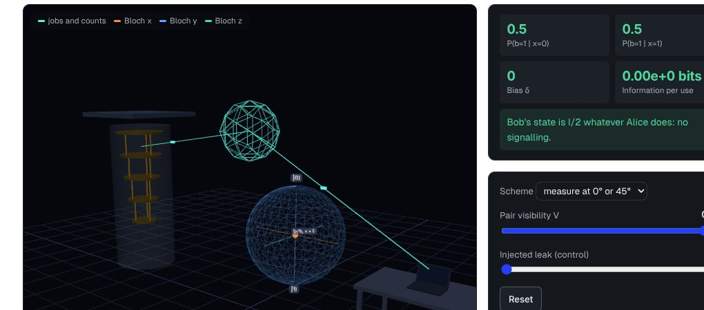</a><br><b>Cloud circuits lab</b> <sup>new</sup><br><sub>The collapse code (P11), teleportation and superdense coding (P12), and Majorana parity teleportation (P13) as exact density matrices, checked against Qiskit Aer, with the desk, the cloud, and the processor in 3D and the commands that run each one on hardware.</sub></td>
</tr>
<tr>
<td width="50%" valign="top"><a href="https://Normansrule.github.io/quantum-link-research/lab/channel/"></a><br><b>Quantum channel lab</b> <sup>new</sup><br><sub>What the trip does to a qubit, drawn as the sphere of polarizations becoming an ellipsoid; a certificate from the BB84 error rates that no classical relay could match; what the channel can carry (bits, qubits, secret key); a tomography run whose log loads into the Python; teleportation as a channel; and superdense coding through the hallway at more than one bit per photon.</sub></td>
<td width="50%" valign="top"><a href="https://Normansrule.github.io/quantum-link-research/lab/outdoor/">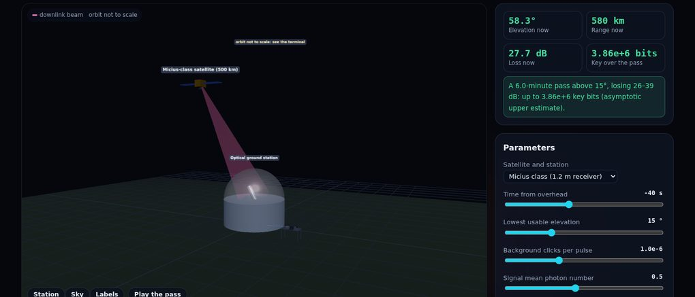</a><br><b>Outdoors and orbit lab</b> <sup>new</sup><br><sub>The link between two roofs, then two buildings at night, then a ground station tracking a Micius-class satellite: the beam spreading, pointing jitter, the air, and the sky's glow as a loss budget and a signal-to-noise chart, the key against distance for each receiver, and a pass you can play second by second.</sub></td>
</tr>
<tr>
<td width="50%" valign="top"><a href="https://Normansrule.github.io/quantum-link-research/lab/frontier/"></a><br><b>Frontier lab</b> <sup>new</sup><br><sub>Teleportation across a distance, honestly timed: a free cloud-processor run with the two bits delayed, a swapping node that learns nothing, photonic teleportation between the rooms, and Earth to Mars with entanglement banked in memories, each drawn as a spacetime diagram in which nothing outruns the light time.</sub></td>
<td width="50%" valign="top"><b>Teleportation never beats light</b><br><sub>What it does instead: the pairs are sent ahead and banked, so at the moment of sending nothing quantum has to survive the trip, only two classical bits that travel at light speed. The frontier lab shows which memories last long enough for which distance, from 1 ms atomic ensembles (a city) to hour-long trapped ions (Mars).</sub></td>
</tr>
<tr>
<td width="50%" valign="top"><a href="https://Normansrule.github.io/quantum-link-research/lab/messenger/">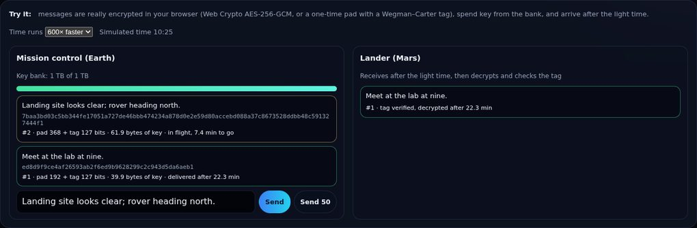</a><br><b>Messenger lab</b> <sup>new</sup><br><sub>A local demonstration of the application on every link: messages encrypted in the browser from a simulated link-key supply (a one-time pad with a Wegman–Carter tag, link-keyed AES-256-GCM, or a hybrid whose KEM secret is simulated), a key bank sized so it never refuses, a messenger that fails closed when it is empty, delivery shown only after an authenticated acknowledgment, and the light time on every message. Both endpoints run in one browser; do not enter sensitive information.</sub></td>
<td width="50%" valign="top"><b>Security, stated plainly</b><br><sub>A one-time pad is information-theoretically secure only if its key is truly random, secret, used once, and paired with authentication, and it spends a key bit per message bit; in the model, the two-room link would key about 60,000 short messages a day that way, and a satellite pass about 2,000. AES-256 under a link key is estimated to keep about 128-bit security against known quantum attacks (Grover search) and keys millions. Today's public-key messengers need no key bank, but a recording can be decrypted later by a large quantum computer. A first Mars messenger can be keyed today by carrying the key: a terabyte of pad lasts tens of thousands of years of texting.</sub></td>
</tr>
<tr>
<td width="50%" valign="top"><a href="https://Normansrule.github.io/quantum-link-research/mars/">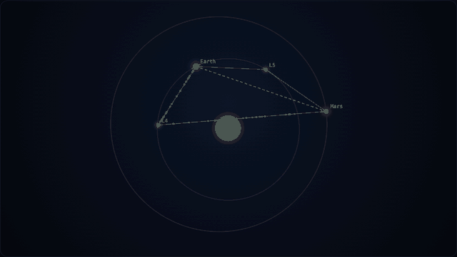</a><br><b>Mars link simulator</b><br><sub>Orbits, conjunction, L4/L5 relays, and which memories outlive today's round trip.</sub></td>
<td width="50%" valign="top"><a href="https://Normansrule.github.io/quantum-link-research/monitor/">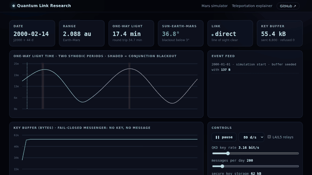</a><br><b>Link monitor</b><br><sub>Two synodic periods of light time and blackouts, and a fail-closed messenger that refuses to send when conjunction drains its key, until relays are switched on.</sub></td>
</tr>
<tr>
<td width="50%" valign="top"><a href="https://Normansrule.github.io/quantum-link-research/teleport/">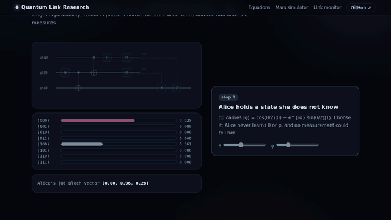</a><br><b>Teleportation, step by step</b><br><sub>Scroll through the protocol with the exact eight-amplitude state (checked against Qiskit to 10⁻¹²), the no-signalling average, and the bits in flight.</sub></td>
<td width="50%" valign="top"><a href="https://Normansrule.github.io/quantum-link-research/#interference">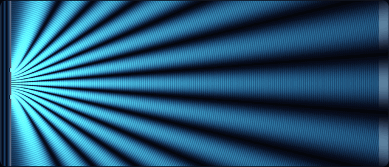</a><br><b>Interference lab</b><br><sub>A WebGL shader sums the two slit waves exactly; which-path information erases the fringes (protocol P06).</sub></td>
</tr>
<tr>
<td width="50%" valign="top"><a href="https://Normansrule.github.io/quantum-link-research/repeater/">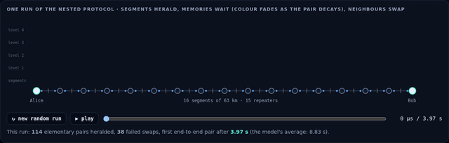</a><br><b>Repeater lab</b> <sup>new</sup><br><sub>One random run of a nested repeater chain: segments herald, stored pairs fade as they decay, swaps join them, failed swaps in red; beside it the average rate against direct fiber and the repeaterless bound, and the fidelity check that rate alone misses.</sub></td>
<td width="50%" valign="top"><a href="https://Normansrule.github.io/quantum-link-research/coupler/">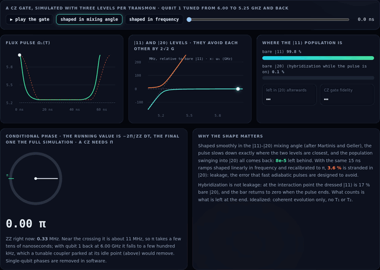</a><br><b>Coupler lab</b><br><sub>Park a tunable coupler where the always-on ZZ vanishes, watch the Ramsey fringes that measure it (E16), and play a simulated CZ gate reaching π with fidelity 0.99998.</sub></td>
</tr>
<tr>
<td width="50%" valign="top"><a href="https://Normansrule.github.io/quantum-link-research/qec/">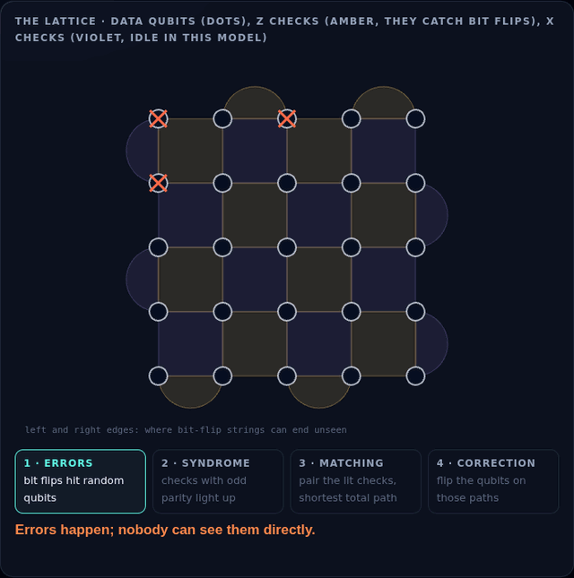</a><br><b>QEC lab</b> <sup>new</sup><br><sub>A distance-5 surface code under bit flips: errors appear, parity checks light up, PyMatching pairs them, and the correction either saves the logical qubit or closes a string across the lattice. Every shot is decoded in the tested Python and re-checked by the page.</sub></td>
<td width="50%" valign="top"><a href="https://Normansrule.github.io/quantum-link-research/budget/">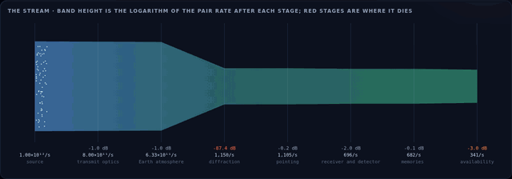</a><br><b>Earth–Mars link budget</b> <sup>new</sup><br><sub>A trillion pairs a second leave the Earth end; the stream narrows at every stage (87 dB of it at diffraction) as Mars recedes. See Earth as the Mars receiver does, at its true phase, and why sunlit ground swamps a transmitter on the ground. Pick the architecture, the memory, the telescopes, the filter, and the day, count the useful teleportations and secret bits that arrive, and size the key bank that carries a messenger through conjunction.</sub></td>
</tr>
</table>

## The argument in five equations

<p align="center">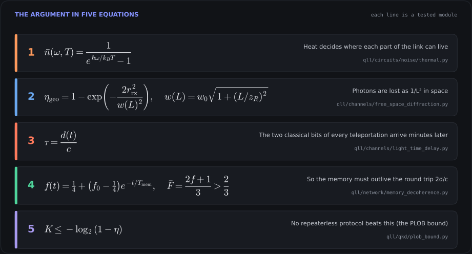</p>

<details>
<summary><b>The same equations as LaTeX</b></summary>

$$\bar n(\omega,T)=\frac{1}{e^{\hbar\omega/k_BT}-1}\qquad\text{heat decides where each part of the link can live}$$

$$\eta_{\rm geo}=1-\exp\left(-\frac{2r_{\rm rx}^2}{w(L)^2}\right),\qquad w(L)=w_0\sqrt{1+(L/z_R)^2}\qquad\text{photons are lost as }1/L^2\text{ in space}$$

$$\tau=\frac{d(t)}{c}\qquad\text{the two classical bits of every teleportation arrive minutes later}$$

$$f(t)=\tfrac14+\left(f_0-\tfrac14\right)e^{-t/T_{\rm mem}},\qquad \bar F=\frac{2f+1}{3}>\frac23\qquad\text{so the memory must outlive }2d/c$$

$$K\le-\log_2(1-\eta)\qquad\text{and no repeaterless protocol beats this}$$

</details>

Each line is a module in [`qll/`](qll) with a test that checks it against its closed form; the full set, with figures, is in [docs/physics_overview.md](docs/physics_overview.md).

## How the code fits together

<p align="center"></p>

## Systems engineering

<p align="center"><a href="https://Normansrule.github.io/quantum-link-research/systems/">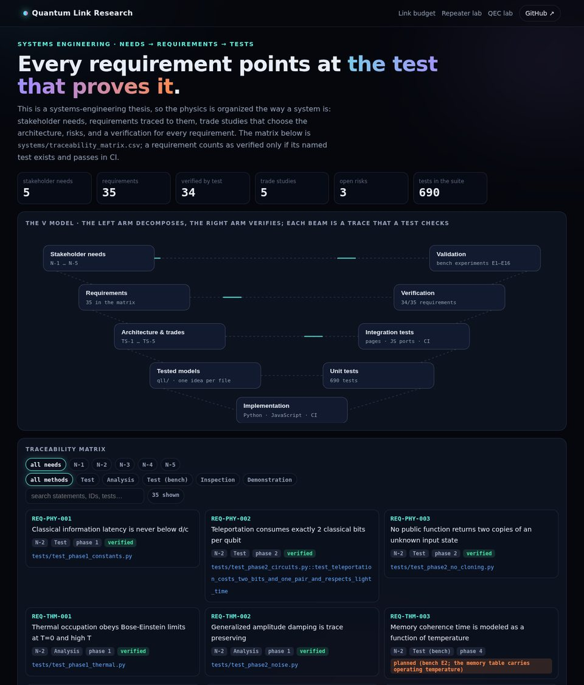</a></p>

This is a systems-engineering thesis, and the repository is organized like a system. Five stakeholder needs ([`systems/needs.md`](systems/needs.md)) trace to the requirements in [`traceability_matrix.csv`](systems/traceability_matrix.csv), each with a verification method and the named test that verifies it; `python -m qll.systems.traceability` fails if a test or test function is missing, and the requirements document ([`systems/requirements.md`](systems/requirements.md)) is generated from the matrix. Five trade studies ([`systems/trade_studies.md`](systems/trade_studies.md)) choose the architecture from tables the code regenerates on every commit, and the risk register, concept of operations, and technology-readiness assessment sit beside them. The [traceability page](https://Normansrule.github.io/quantum-link-research/systems/) puts it all on a V model you can filter.

### The two-site key link (SEE 510 case study)

[`systems/see510/`](systems/see510/README.md) takes flagship F1 down to a laboratory key link between Site A and Site B and simulates it end to end:

- BB84 states from an ideal single-photon source or an attenuated laser with decoy states, through a fiber of configurable length;
- detectors with finite efficiency and dark counts;
- two textbook adversaries: intercept-and-resend, and photon-number splitting on a laser source;
- Cascade error correction with hash verification, and privacy amplification;
- a classical channel authenticated with Wegman–Carter tags that fails closed and stays failed; in simulation a seeded ledger stands in for the authentication key, while a secret pool consumes real bytes and is replenished only from accepted key with recorded provenance;
- key delivery to an AES-256-GCM demonstration application through an ETSI GS QKD 014-style interface.

Twelve validation cases match closed-form models, and every run reproduces from its configuration and seed. A [real-world ladder](systems/see510/10_real_world_experiments.md) builds it in five tiers, from a $40–120 Arduino-and-polarizer analogue through fiber characterization and single-photon BB84 to entanglement-based BBM92. Each tier's log runs through the same protocol code with `python -m qll.link.run ingest`. Fifteen stakeholder needs trace to modules, tests, and [evidence](systems/see510/evidence/README.md). `python -m qll.link.run scenarios` regenerates the evidence in about 45 seconds. A scripted [operations day](systems/see510/evidence/operations/README.md) runs 96 sessions through drift, interception, a fiber bend, tampering, and a fiber cut; the [operations console](https://normansrule.github.io/quantum-link-research/link/) replays it, and shows the link failing closed during the cut.

<p align="center"><a href="systems/see510/evidence/README.md">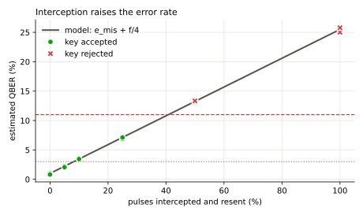</a> <a href="systems/see510/evidence/README.md">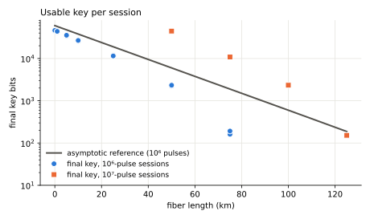</a></p>

### The mission: from two rooms to orbit

[`systems/program/`](systems/program/README.md) turns the research into one phased plan, with gates, three-point costs, a critical-path schedule, a risk register, trade studies, and a path to a company:

1. **Phase 1, two rooms (planning estimate: about $690 likely).** A fiber classical channel between two rooms. Single-photon BB84 with decoys through an enclosed free-space path, using four silicon photomultipliers ([P10](experiments/protocols/P10_two_room_single_photon_link.md)), compared line by line with a planning model; blocked until a qualified safety review is recorded ([evaluation specification](experiments/specs/two_room_evaluation_spec.md)). The collapse code on a free cloud processor ([P11](experiments/protocols/P11_collapse_code_on_a_cloud_processor.md)): a bound, to be measured, on whether the way a shared state collapses can carry a message (quantum mechanics says it carries none).
2. **Phase 2, entanglement between the rooms.** A borrowed source, a Bell test, an entanglement-based key, and superdense coding through the hallway: more than one bit per photon ([E19](experiments/proposed/E19_superdense_coding_through_the_hallway.md)).
3. **Phase 3, outdoors and toward orbit.** Free space between roofs and buildings, a ground station, and a satellite only with a partner. The [outdoor lab](https://normansrule.github.io/quantum-link-research/lab/outdoor/) shows what to expect: the SiPMs of P10 make no key outdoors, avalanche-diode modules reach about 2 km at night, daylight swamps a 405 nm receiver, and a Micius-class pass loses 26–39 dB ([`qll/link/outdoor_link.py`](qll/link/outdoor_link.py), [`qll/link/satellite_pass.py`](qll/link/satellite_pass.py)).
4. **Phase 4, the frontier.** Entanglement-assisted communication: teleportation and superdense coding, each with its classical channel. The first step is free: teleportation on a cloud processor with the two bits delayed, whose fidelity follows the qubit's own T₁ and T₂ down through 2/3 after about 110 µs ([E01](experiments/proposed/E01_delayed_classical_channel_teleportation.md)). The [frontier lab](https://normansrule.github.io/quantum-link-research/lab/frontier/) carries the same timing to a swapping node, the rooms, and Mars ([`qll/network/teleport_across.py`](qll/network/teleport_across.py)).

**The application.** [P15](experiments/protocols/P15_messages_keyed_by_the_link.md) spends the link's key on messages and measures how many a day each link can key and how big a key bank keeps the messenger from refusing ([`qll/link/keyed_messaging.py`](qll/link/keyed_messaging.py)); the [messenger lab](https://normansrule.github.io/quantum-link-research/lab/messenger/) does it live in the browser.

**Quantum channels.** The hallway already carries qubits, not just key bits. [P14](experiments/protocols/P14_the_hallway_as_a_quantum_channel.md) certifies it as a quantum channel from the BB84 counts within a trusted qubit model (no classical relay could match them), maps it by process tomography with two $10 quarter-wave plates, and computes what it can carry; the same analysis shows that teleportation is a quantum channel only with its two classical bits ([09](systems/program/09_quantum_channels.md)).

Every experiment already in the repository is catalogued with the phase it feeds and what it takes to replicate it ([02](systems/program/02_research_foundation.md)). The [lab](https://normansrule.github.io/quantum-link-research/lab/) lists all of them and opens the ones with a build in 3D, from a starter to the real-world option ([`qll/systems/lab_scenes.py`](qll/systems/lab_scenes.py)).

<p align="center"><a href="systems/program/01_phases_and_milestones.md">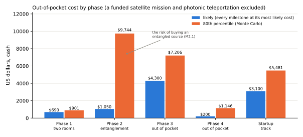</a></p>

## Three experiments, one physics

<p align="center">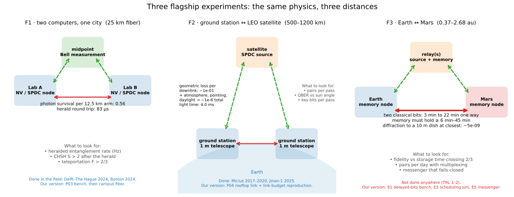</p>

| | F1 · two computers, one city | F2 · Earth ↔ satellite | F3 · Earth ↔ Mars |
|---|---|---|---|
| **What** | heralded entanglement and teleportation over 25 km of fiber | single-photon downlink from low orbit | the same protocol with a 6–45 min round trip |
| **State of the art** | done in the field (2024) | Micius 2017, Jinan-1 2025 | done nowhere |
| **Our version** | P03 bench → campus fiber | Micius budget reproduced within 3 dB → rooftop link | delayed-bits bench, relay scheduling, fail-closed messenger |
| **Plan** | [F1](experiments/flagship/F1_earth_to_earth.md) | [F2](experiments/flagship/F2_earth_to_satellite.md) | [F3](experiments/flagship/F3_earth_to_mars.md) |

### F3 on a table: build it, stage by stage

<p align="center"><a href="experiments/protocols/P09_mars_link_on_a_table.md">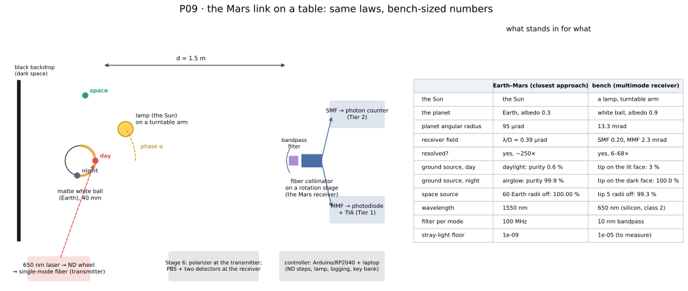</a></p>

Protocol [P09](experiments/protocols/P09_mars_link_on_a_table.md) turns the Earth–Mars results into a bench you can build for a few hundred dollars: a lamp for the Sun, a matte white ball for Earth, a fiber tip for the transmitter, and a fiber collimator for the Mars receiver. Eight stages, from simulation only to photon counting, each with a prediction, a log format, and a pass criterion. A tested digital twin (`qll/systems/bench_twin.py`) predicts every reading with the same functions that evaluate the Mars link. `python -m qll.analysis.bench_report synthetic` and `report` run the whole analysis today on synthetic data; the [bill of materials](experiments/bench/P09_bill_of_materials.md) is tiered from $0 to photon counting.

<p align="center"><a href="experiments/done/README.md"></a></p>

## What is inside

| | | |
|---|---|---|
| 📚 **[Learn](learn/README.md)**<br>foundations, computing core, eight qubit platforms, communication; every file with equations, a figure, references, and exercises | 🧪 **[Experiments](experiments/README.md)**<br>three flagships, nine bench protocols, fifteen landmark experiments with cheap recreations, sixteen proposals, lessons | 🔭 **[Research](research/README.md)**<br>timeline, open problems, fifteen frontier theories, design process, thesis chapters |
| 💻 **[`qll/`](qll)**<br>tested physics from thermal occupation to a fail-closed Mars messenger, with Qiskit Aer, Stim, QuTiP, SeQUeNCe, and Perceval adapters | 🎛️ **[Simulations](simulations/README.md)**<br>eight scripts that predict what each bench must reproduce | 🎓 **[Course](learn/COURSE_SYLLABUS.md)**<br>15 weeks, four machine-graded problem sets |
| 📈 **[Data](data/README.md)**<br>tested analysis pipelines waiting for the first ODMR (optically detected magnetic resonance) and T₁(T) measurements | 🎬 **[YouTube](youtube/README.md)**<br>verified English videos per topic | 📖 **[References](docs/references.md)**<br>a bibliography that every code citation is checked against |

## Figures

Every figure is drawn by a function under test; `python scripts/make_figures.py` regenerates all of them.

<table>
<tr>
<td width="50%">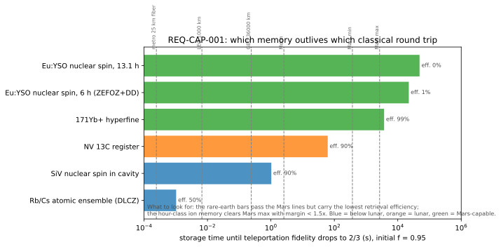</td>
<td width="50%">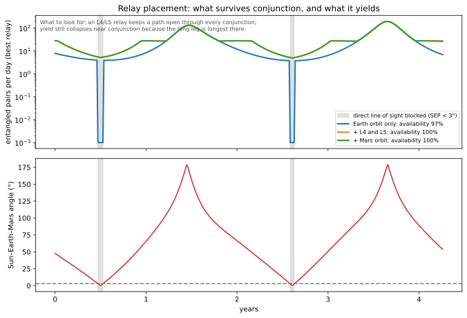</td>
</tr>
<tr>
<td width="50%">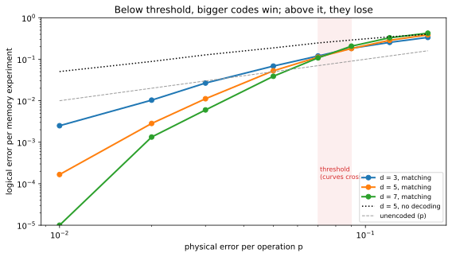</td>
<td width="50%">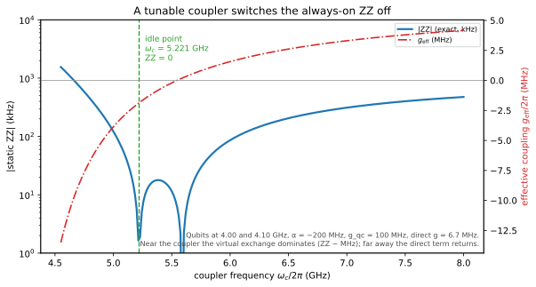</td>
</tr>
<tr>
<td colspan="2">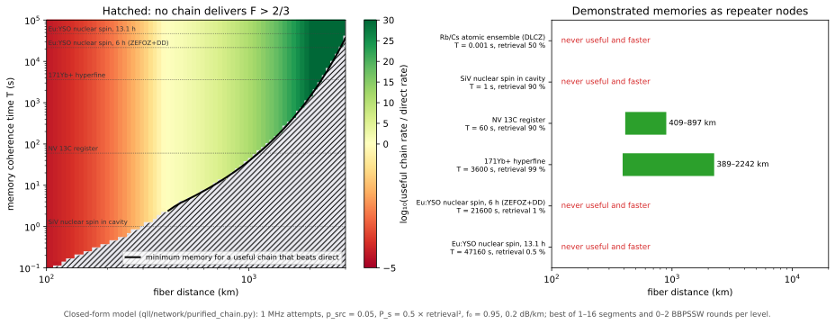</td>
</tr>
<tr>
<td colspan="2">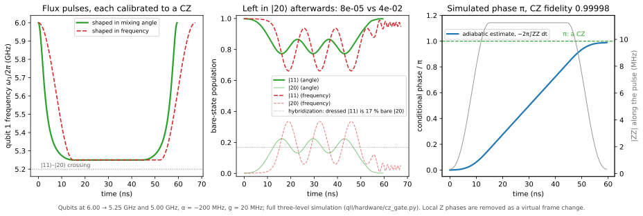</td>
</tr>
</table>

<details>
<summary><b>More figures</b></summary>

<table>
<tr>
<td width="50%">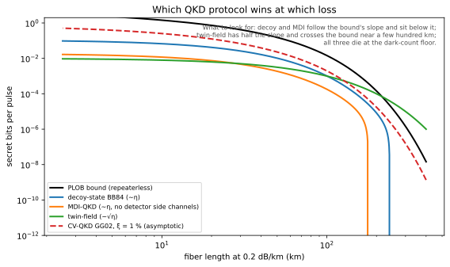</td>
<td width="50%">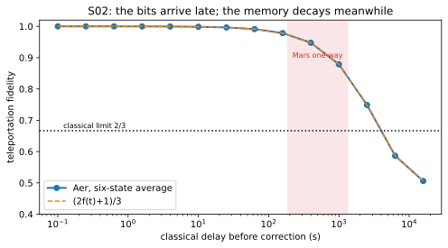</td>
</tr>
<tr>
<td width="50%">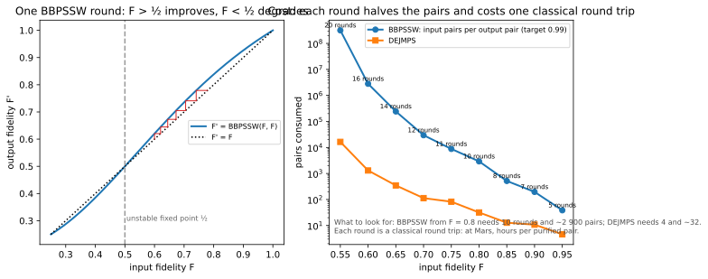</td>
<td width="50%">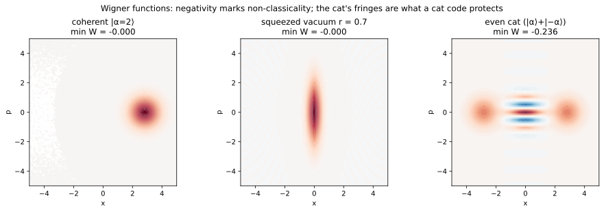</td>
</tr>
<tr>
<td width="50%">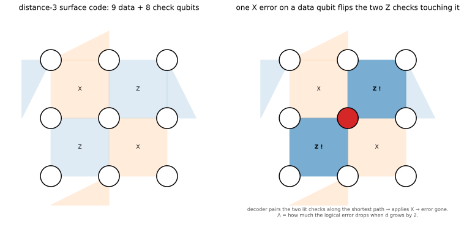</td>
<td width="50%">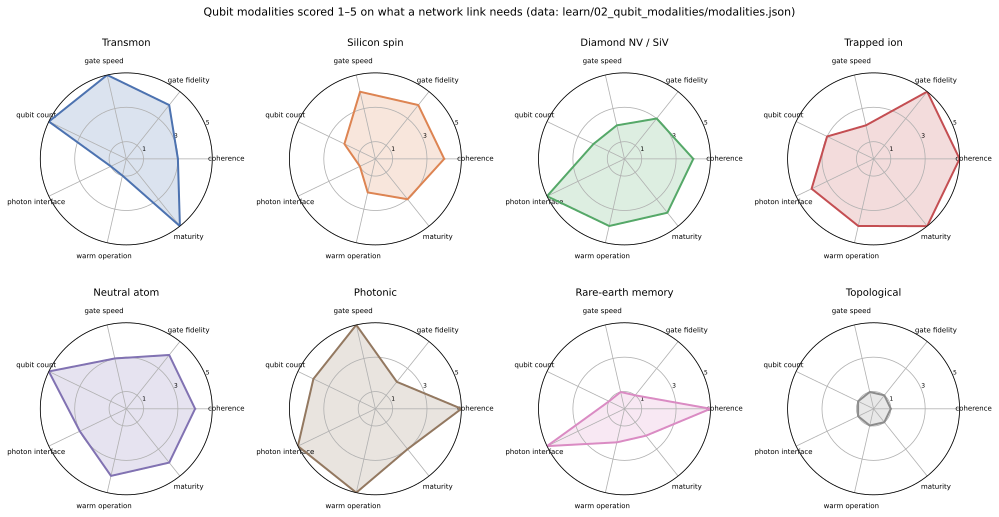</td>
</tr>
<tr>
<td width="50%">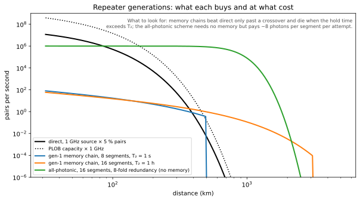</td>
<td width="50%">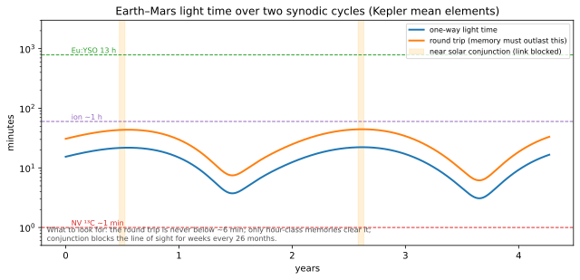</td>
</tr>
<tr>
<td colspan="2">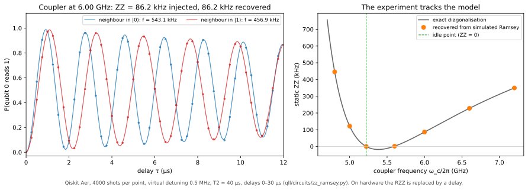</td>
</tr>
<tr>
<td colspan="2">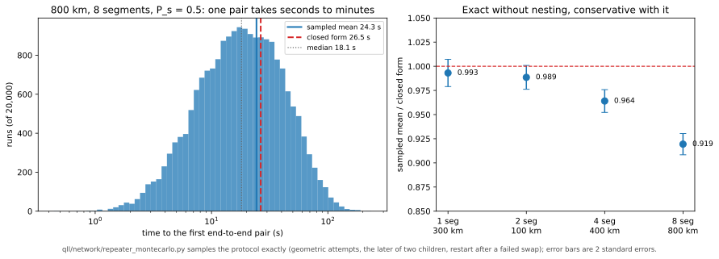</td>
</tr>
</table>

</details>

## Run it

The commands, the supported environment, and the checks that must pass are in the [README quickstart](README.md#run-a-simulation).

<details>
<summary><b>Phases</b></summary>

| Phase | Deliverable | Must pass | Status |
|---|---|---|---|
| 1 | constants, channels, thermal model, QKD theory, explorers, library | analytic and integrity tests | **done** |
| 2 | Bell, teleportation, swapping, CHSH, fidelity, tomography, Kraus noise, no-cloning guard | $F_{\rm ideal}=1$; $F=(2f+1)/3$; $S=2\sqrt2$ | **done** |
| 3 | atmosphere, turbulence, pointing, link budget; BB84/E91/decoy/MDI/TF/CV; sources, detectors, NV node | Micius within 3 dB; rates ≤ PLOB | **done** |
| 4 | memories, purification (BBPSSW, DEJMPS), repeaters, scheduling, routing | chain beats direct; $T_{\rm mem}$ vs $2d/c$ | **done** |
| 5 | Kepler ephemeris, conjunction, relays, relativity, flown coolers, DSOC-class link | envelope within 1 %; L4/L5 > 99.9 % availability | **done** |
| 6 | ML-KEM + QKD hybrid, AES-GCM, fail-closed messenger, benchmark | never sends unkeyed | **done** |
| — | bench data (P01 ODMR, P02 T₁ vs temperature, P09 the Mars link on a table) | REQ-THM-003, REQ-CHN-003 | **waiting on hardware**; P09's twin and analysis are tested |

</details>

<details>
<summary><b>Map of the repository</b></summary>

```
qll/            tested physics: constants → channels → circuits → qkd → network → space → app, plus hardware, analysis, viz
simulations/    S01–S08: predictions for each bench            data/       measured CSVs + tested fit pipelines
learn/          settled physics, course, problem sets           experiments/ flagships, protocols, landmarks, proposals, lessons
research/       frontier theories, timeline, thesis             docs/       website, explorers, figures, bibliography, status
systems/        needs, requirements, traceability, risks, TRL   tests/      500+ tests, run on every commit
```

</details>

## Built on the shoulders of

The website and these README images re-implement ideas from twelve open-source projects. No code was copied; [CREDITS.md](CREDITS.md) records exactly what each one contributed.

| Project | What it inspired here |
|---|---|
| [**Magic UI**](https://github.com/magicuidesign/magicui) | number tickers and bento grid (the numbers card above), AnimatedBeam (the stack diagram and the repeater lab's links), Marquee (the landmark strip) |
| [**react-bits**](https://github.com/DavidHDev/react-bits) | gradient text, blur-in reveals, and spotlight cards on the website; the rotating "shine" borders on the README cards |
| [**Animate UI**](https://animate-ui.com/) · [**motion-primitives**](https://github.com/ibelick/motion-primitives) | staggered entrances and easing curves; restrained glass panels |
| [**llm-viz**](https://github.com/bbycroft/llm-viz) · [**transformer-explainer**](https://github.com/poloclub/transformer-explainer) | step-through explainers that show the real internal state: the teleportation page, the coupler lab's CZ player, the repeater lab's sampled run, the QEC lab's decoding steps, and the memory-versus-round-trip chart |
| [**WebGL-Fluid-Simulation**](https://github.com/PavelDoGreat/WebGL-Fluid-Simulation) | a full-canvas fragment shader driven by the pointer: the interference lab |
| [**folio-2019**](https://github.com/brunosimon/folio-2019) | the landing page as a 3-D scene to explore: the three.js Solar System |
| [**gods-eye-view**](https://github.com/bilawalsidhu/gods-eye-view) · [**worldmonitor**](https://github.com/koala73/worldmonitor) | a live situation view and a dashboard of tiles, timelines, and an event feed: the hero's live strip, the link monitor, and the link budget |
| [**GSAP**](https://github.com/greensock/GSAP) | used directly for scroll reveals, tickers, and explainer steps |
| [**Remotion**](https://github.com/remotion-dev/remotion) | rendering the product itself into the README's motion, done here with Playwright frame capture; the link budget's flowing pair stream |
