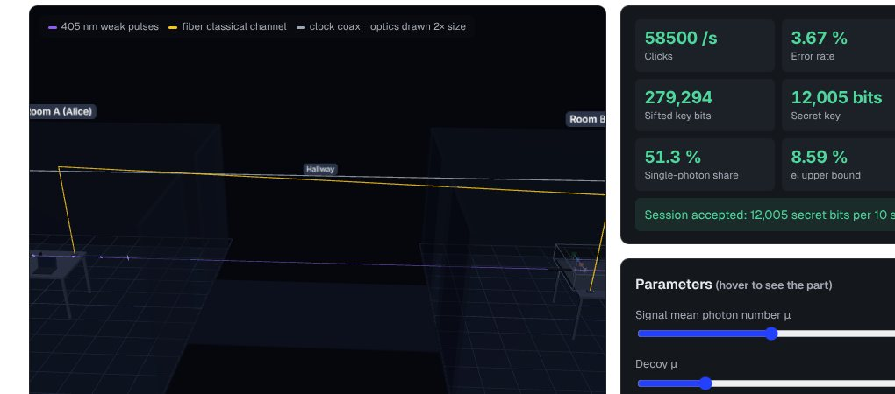
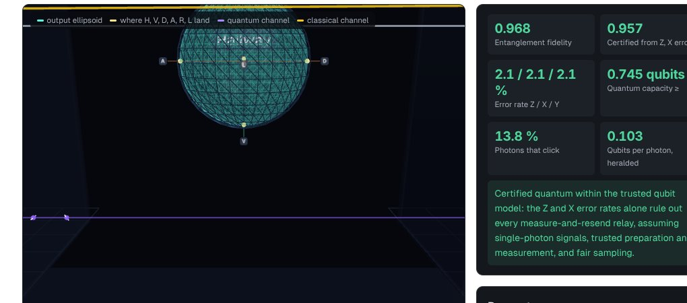
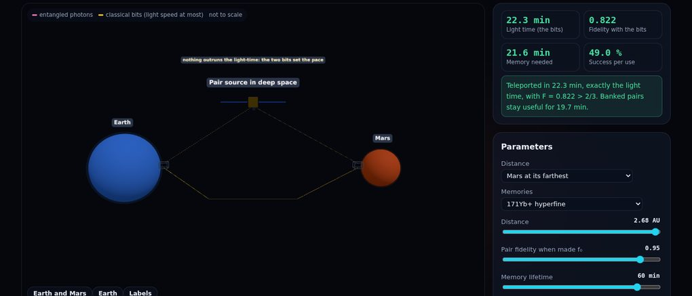

# Quantum Link Research

**Physics-first simulations, interactive teaching labs, and a staged two-room quantum-communication experiment.**

[Explore the website](https://normansrule.github.io/quantum-link-research/) · [Run a simulation](#run-a-simulation) · [Explore the labs](#explore-the-labs) · [Build the two-room experiment](#build-the-two-room-experiment) · [Review the evidence](#verification-and-evidence)

<p>
  <a href="https://github.com/Normansrule/quantum-link-research/actions/workflows/ci.yml"></a>
  <a href="https://github.com/Normansrule/quantum-link-research/actions/workflows/ci.yml"></a>
  <a href="CHANGELOG.md"></a>
  <a href="docs/status.md"></a>
  <a href="docs/references.md"></a>
  <a href="learn/README.md"></a>
</p>

Quantum Link Research connects equations, executable models, visual explanations, and experimental procedures. Start with a local simulation, learn how a protocol behaves under noise and interception, and then compare its predictions with a controlled laboratory measurement. It is Aleksander Norman's systems-engineering project at California State University, Dominguez Hills (CSUDH).

Advanced repeater, quantum-memory, and Earth–Mars studies are **research models**, not demonstrated hardware links. They live in the [project tour](PROJECT_TOUR.md).

> **Development status: experimental research software, not a production cryptographic system.** The audited 0.55.0 revision (`721889d`) failed its Python and browser CI jobs and had open security-state defects. Version 0.56.0 repairs the findings listed in the [audit findings matrix](docs/audit/2026-10-11_findings.md) and passes locally on Linux; it is not yet confirmed by a passing CI run on GitHub. The tests badge above is written by the CI run that built the deployed website; until it reports a pass for the current commit, treat the baseline as unverified. Do not use simulated keys or the browser messenger for sensitive data.

## Choose your path

| Your goal | Start here | What you will get |
|---|---|---|
| Understand quantum communication | [Learning guide](learn/README.md) and the [interactive website](https://normansrule.github.io/quantum-link-research/) | Explanations and controllable models |
| Run or modify the code | [Simulation quickstart](#run-a-simulation) and [`qll/link/`](qll/link/) | Reproducible inputs, protocol outcomes, and tests |
| Build a practical experiment | [Two-room plan (P10)](experiments/protocols/P10_two_room_single_photon_link.md) and its [evaluation specification](experiments/specs/two_room_evaluation_spec.md) | A staged procedure that must be safety-reviewed and calibrated before any hardware use |
| Evaluate the research | [Physics overview](docs/physics_overview.md), [references](docs/references.md), [thesis draft](research/thesis/THESIS_DRAFT.md), and the [project tour](PROJECT_TOUR.md) | Equations, assumptions, sources, and open questions |

## What is implemented?

Implemented is not the same as tested, tested is not the same as measured, and measured is not the same as secure under a stated threat model.

| Component | Implemented | Tested | Measured | Security-reviewed |
|---|---|---|---|---|
| BB84 link pipeline: decoy states, Cascade reconciliation, privacy amplification, key accounting | Yes, simulation | Against closed-form models | No | No; finite-key length is a simplified estimate |
| Authentication and key lifecycle: OPEN/VERIFIED/FAILED channel, one-time key store, seeded simulation ledger or a secret byte pool | Yes | Sticky failure, sealed transcript, reuse, and atomicity tests | No | No |
| Two-site log workflow: strict per-site CSV parsing with SHA-256 provenance | Yes, offline analysis | Invalid-log regressions | Synthetic logs only, labelled synthetic | No |
| Classical transport: session-bound authenticated TCP (a lab construction) | Yes | Replay, reflection, timeout, and partial-frame tests on loopback | No | No; mutual TLS is the recommended replacement |
| Independent endpoints running the full protocol | No; both sites share one process | Not applicable | No | No |
| Browser labs and messenger | Local demonstrations; simulated key supply and simulated KEM secret | Headless Chromium tests | No | No |
| Two-room optics (P10) | Planning model and procedure; FPGA timing planned, not implemented | Model only | No; safety review BLOCKED | No |
| Earth–Mars, repeater, and memory studies | Analytic budgets | Against limiting cases | No | Not applicable |

For the two-room experiment the paths are separate: **fiber Ethernet carries only the classical channel; the initial P10 quantum path is free space, inside an enclosed path between the rooms.** A bright-light polarization analogue is educational, not secure quantum key distribution (QKD).

## How the link fits together

```text
Site A                                         Site B
preparation / emission  -- quantum path -->    measurement / detection
        |                                              |
        +------- authenticated classical messages -----+
        |                                              |
        +-- parameter estimation and reconciliation ---+
        +-- verification and privacy amplification ----+
        |                                              |
 accepted key material                          accepted key material
        |                                              |
        +-------- application / key accounting --------+
```

This is a conceptual view. Each run labels which blocks are simulated, analyzed offline, or physically present: `python -m qll.link.run session` prints its execution mode, its execution identifier, and whether its authentication pool is a seeded simulation ledger. Authentication is required, and a low observed error rate alone does not prove that a finite key is secure.

## Run a simulation

The supported environment is Python 3.12 in the pinned Conda environment, on Linux or Windows (CI runs both). From a checkout:

```bash
git clone https://github.com/Normansrule/quantum-link-research.git
cd quantum-link-research
conda env create -f environment.yml
conda activate qll
python scripts/check_env.py
python -m qll.link.run session
```

The session prints the configuration, the observed errors, the acceptance decision, and the modelled key accounting. A reproducible seed helps debugging; it is **not a source of secret entropy**.

```bash
python -m qll.link.run validate          # exits 1 if any validation check fails
python -m pytest -q -m "phase1 and not slow"
python -m pytest -q -m "not slow"        # the broad suite
python -m pytest -q -m browser           # headless Chromium: pip install playwright && python -m playwright install chromium
```

Locally, a missing optional tool (Node.js, Chromium, an optional simulator) skips its tests. In CI, each job lists what it requires in `QLL_REQUIRE`, and a skip for a required tool fails the job ([`tests/conftest.py`](tests/conftest.py)).

## Explore the labs

```bash
python -m http.server --bind 127.0.0.1 --directory docs 8000
```

Open `http://127.0.0.1:8000`. The site vendors its libraries and generated data, so it works offline. Animations compress time and use illustrative quantities; they are not experimental evidence.

<table>
<tr>
<td width="33%" valign="top"><a href="https://normansrule.github.io/quantum-link-research/lab/link/#two_room"></a><br><b>Two-room link lab</b><br><sub>Every planned part, its price, and the model's math.</sub></td>
<td width="33%" valign="top"><a href="https://normansrule.github.io/quantum-link-research/lab/channel/"></a><br><b>Quantum channel lab</b><br><sub>What the trip does to a qubit, within a trusted qubit model.</sub></td>
<td width="33%" valign="top"><a href="https://normansrule.github.io/quantum-link-research/lab/frontier/"></a><br><b>Frontier lab</b><br><sub>Teleportation timed honestly: nothing outruns light.</sub></td>
</tr>
</table>

More pages: [teleportation, step by step](https://normansrule.github.io/quantum-link-research/teleport/) · [Earth–Mars link budget](https://normansrule.github.io/quantum-link-research/budget/) · [messenger lab](https://normansrule.github.io/quantum-link-research/lab/messenger/) · [all labs](https://normansrule.github.io/quantum-link-research/lab/) · [every page, described](PROJECT_TOUR.md#the-website).

## Build the two-room experiment

Begin with the simulation and the classical transport, then a controlled polarization analogue, then detector and source characterization. Read [P10](experiments/protocols/P10_two_room_single_photon_link.md) as a planning document: its build status is **BLOCKED** until a qualified review of the actual source, accessible emissions, and alignment is recorded in the [evaluation specification](experiments/specs/two_room_evaluation_spec.md). Never route an exposed beam through a hallway or other occupied space, and never treat a nominal attenuator setting as proof of safety.

Do not buy the whole hardware list before checking detector noise, timing, the optical-loss budget, available instruments, and a safe test arrangement. Record source type, calibration, uncertainty, instrument and firmware identifiers, and raw per-site logs, and label every result **synthetic**, **analogue**, or **single-photon experimental data**. A positive acceptance decision in the simulation does not promote a measured run to a secure implementation. The [bill of materials and build order](#build-the-main-experiment-phase-1) close this page.

## Verification and evidence

[CI runs](https://github.com/Normansrule/quantum-link-research/actions/workflows/ci.yml) · [tests](tests/) · [requirements status](docs/status.md) · [audit findings matrix](docs/audit/2026-10-11_findings.md) · [reference index](docs/references.md)

- **Release gate.** CI runs the tests on Linux and Windows and the browser suite in headless Chromium, uploads JUnit reports even on failure, and deploys the website only from a revision on which every required job passed. The deployed site carries `ci_status.json`, `badges/tests.json`, `REVISION`, and a `MANIFEST.sha256` of its files.
- **Requirements.** `python -m qll.systems.traceability --junit <report.xml>` counts a requirement as proven only when its mapped tests ran and passed in that report. The counts in [docs/status.md](docs/status.md) are an inventory, not a result.
- **Numbers.** Analytic expectations, simulated samples, and measurements are kept apart. Python and JavaScript share computed data, which keeps the displays consistent; that is a consistency check, not independent validation. Finite-key and device-independent estimates are heuristics unless a matching proof and its assumptions are stated, and a long spin coherence does not by itself make a capable photonic memory.

## Repository map

| Location | Purpose |
|---|---|
| [`qll/`](qll/) | Protocol, physics, systems, and application models |
| [`tests/`](tests/) | Automated behavior and model checks |
| [`learn/`](learn/) | Learning paths and explanations |
| [`experiments/`](experiments/) | Laboratory procedures, specifications, and staged experiments |
| [`systems/`](systems/) | Requirements, configurations, and program planning |
| [`docs/`](docs/) | Website, figures, references, audit records, and generated status |
| [`research/`](research/) | Thesis work and advanced research directions |

## Contributing

Start from a stated problem or a failing test. Explain the assumptions, preserve raw evidence, and name any public claim the change affects; never replace a failing scientific check with a favorable constant or mark unexecuted work as verified. The rules are in [CONTRIBUTING.md](CONTRIBUTING.md), citation metadata in [CITATION.cff](CITATION.cff), and credits in [CREDITS.md](CREDITS.md). The package is MIT licensed ([LICENSE](LICENSE)); check the notices of bundled third-party assets before redistributing them.

<!-- build-guide:start -->

## Build the main experiment: Phase 1

The main experiment is [P10](experiments/protocols/P10_two_room_single_photon_link.md): single photons between two rooms. Weak 405 nm pulses at about half a photon each carry four polarizations through an enclosed free-space path between the rooms, decoy pulses guard against photon-number attacks, and four silicon photomultipliers read them in the other room. A separate fiber Ethernet link carries only the classical channel. The planning model predicts a click on 5.85 % of pulses, an error rate of 3.7 %, and about 12,000 test-key bits from each ten-second session; these are model outputs, not measurements, and the key would have no security review. The [link lab](https://normansrule.github.io/quantum-link-research/lab/link/#two_room) shows every part in 3D at the price below.

> **Before building.** P10 is a planning document, not a laser-safety authorization: its build status is BLOCKED until a qualified review of the actual source, accessible emissions, and alignment is recorded in the [evaluation specification](experiments/specs/two_room_evaluation_spec.md). The FPGA timing system is planned, not implemented. Do not buy the whole list before the detector noise, timing, loss budget, instruments, and a safe test arrangement are checked.

**Bill of materials (planning prices, October 2026; verify before buying; instruments and contingency not included)**

| Item | For | Cost |
|---|---|---|
| Two laptops with Ethernet | the two sites | owned |
| Two fiber media converters and a 10–30 m duplex patch cord | classical channel (M1.1) | $40–150 |
| Four 405 nm laser diodes (5 mW class) with a nanosecond pulse driver | the four BB84 states | $40–120 |
| Film polarizers, a half-wave retarder, neutral-density filters (OD 1–4) | encoding and attenuation | $50–120 |
| Four non-polarizing beamsplitters and two polarizing beamsplitters | combining and analysis | $100–250 |
| Four onsemi MicroFC-30035 SiPMs, breakouts, a 30 V boost module, four fast comparators | detection | $230–350 |
| Two small FPGA boards (planned; gateware not yet implemented) | timing | $30–80 |
| A coaxial cable or second fiber for the pulse clock | synchronization | $10–30 |
| 3D-printed mounts, black tubes, lens pairs, black card, felt | mechanics | $30–80 |
| **Total** | | **$530–1,180** |

**Phase 1 budget by milestone** (low, likely, and high, from [`qll/systems/program_plan.py`](qll/systems/program_plan.py)). The milestones count what each step adds, including the $40–120 bright-light analogue that comes first and the open-access fee for the paper. The likely total is $690, and the high case stays within $1,400.

| Milestone | What | Low | Likely | High |
|---|---|---|---|---|
| M1.1 | Fiber classical channel between the rooms (media converters, patch cord, authenticated frames) | $40 | $70 | $150 |
| M1.2 | The collapse code on a cloud processor (P11) and paper 1 | $0 | $0 | $0 |
| M1.3 | Tier 1 bright-light analogue across the rooms | $40 | $80 | $120 |
| M1.4 | Silicon photomultiplier receiver, characterized against its datasheet | $150 | $250 | $400 |
| M1.5 | Pulsed 405 nm source with decoy drive, mean photon number calibrated | $80 | $150 | $300 |
| M1.6 | Two-room single-photon BB84 with decoys (P10), matched to its twin | $60 | $120 | $250 |
| M1.8 | The hallway certified and mapped as a quantum channel (P14) | $10 | $20 | $30 |
| M1.7 | Paper 2: a twin-validated single-photon link for under $1,000 | $0 | $0 | $150 |
| **Phase 1** | | **$380** | **$690** | **$1,400** |

**Build order.** Each stage is checked against the planning model before the next one starts.

0. **Simulate first.** Predict the bench and write a synthetic run ($0).
1. **Classical channel.** Laptops, media converters, fiber through the door (M1.1).
2. **Bright analogue across rooms.** Tier 1 through the enclosed path between the rooms (M1.3); an analogue, not secure QKD.
3. **Single-photon receiver.** SiPMs, comparators, dark box; measure dark counts (M1.4).
4. **Source.** Four diodes, polarizers, combiners, filters to μ = 0.5 (M1.5).
5. **Receiver optics.** Passive basis choice, PBS arms, waveplate at 22.5°.
6. **Sessions.** Clock over coax, gated counting, logs, twin check (M1.6).
7. **Eavesdropper.** Optional intercept-resend station inside the enclosed path.

```
python -m qll.link.run session --config systems/see510/hardware/two_room.json         # predict and write a synthetic run ($0)
python -m qll.link.run ingest room_a.csv --bob room_b.csv --config systems/see510/hardware/two_room.json   # your real logs
```

## Scale the Majorana research: from one hop to a chain

Crogman, Dang, and Erenso (2025) teleport a qubit between Majorana-encoded qubits using joint parity measurements alone. The repository emulates their protocol on a free cloud processor, then scales it from one hop to a chain of hops. Each hop is the same local Bell measurement wherever it sits in the chain, because the Jordan–Wigner strings of neighbouring modes cancel, and each hop needs its own two classical bits. The chain's fidelity falls as $F_N = \tfrac12(1 + k\,s^N)$, and the paper's error budget turns a target chain length into a requirement on the device.

| Step | What | Hardware | Cost | Status |
|---|---|---|---|---|
| 1. [P13](experiments/protocols/P13_majorana_teleportation_on_a_cloud_processor.md) (M4.6) | The paper's protocol, one hop: two parity bits against one | 3 qubits on a free cloud processor | $0 | device-copy rehearsal: 0.835 with two bits, 0.641 with one; hardware run next |
| 2. [E20](experiments/proposed/E20_majorana_parity_teleportation_chain.md) (M4.8) | The same protocol along 1, 2, 3, … hops; fit the loss per hop | 2N + 1 qubits in a line | $0 | device-copy rehearsal: 0.837, 0.797, 0.796 for 1–3 hops; *s* ≈ 0.94, *k* ≈ 0.70, about 11 hops above 2/3; hardware run next |
| 3. Device requirement | Readout and poisoning a chain of N hops needs | the error budget | $0 | table below |
| 4. Tetron devices | Four Majorana modes per qubit at fixed parity, with the CSUDH authors and a device group | a partner's dilution refrigerator | outside funding | research version of E18 and E20 |

**What a Majorana chain needs.** Assume a gap Δ/*kT* = 5, poisoning 0.001 per readout window, and *L*/ξ = 6. The table gives the smallest parity-readout signal-to-noise ratio μ₀/σ that keeps the chain above each fidelity:

| Hops | Above 2/3 | Above 0.9 | Above 0.99 |
|---|---|---|---|
| 1 | 0.92 | 1.66 | 2.65 |
| 4 | 1.56 | 2.25 | 3.21 |
| 16 | 2.17 | 2.79 | not reachable |
| 64 | 2.71 | 3.42 | not reachable |
| 128 | 2.98 | not reachable | not reachable |

Where a cell says "not reachable", poisoning alone caps every hop and no readout can compensate. Scaling the protocol therefore asks first for longer quasiparticle-poisoning times, and only then for better readout.

```
python experiments/bench/frontier/run_frontier.py majorana --backend aer                      # one hop (P13)
python experiments/bench/frontier/run_frontier.py chain --backend aer --hops 1 2 3            # the chain (E20)
python experiments/bench/frontier/run_frontier.py chain --backend ibm_torino --layout 0 1 2 3 4 5 6 7 8 --hops 1 2 3 4
```

<!-- build-guide:end -->
